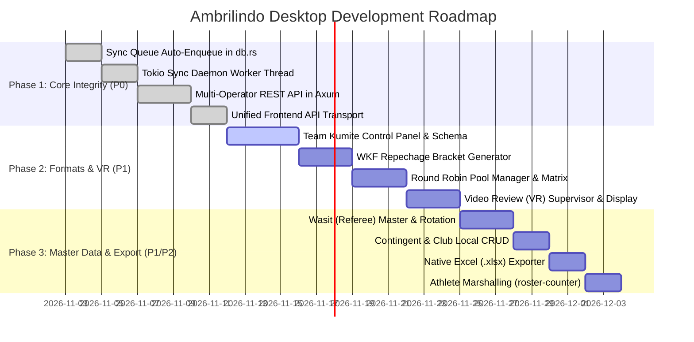

# PRD & Technical Roadmap: Ambrilindo Arena Desktop

> **Document Version**: 1.0.0  
> **Target System**: `ambrilindo_desktop` (Tauri v2 + SvelteKit 5 + Rust)  
> **Benchmark System**: `ambrilindo/ambrilindo` (Django 5.2 Local Venue Server)  
> **Status**: Approved Roadmap & Implementation Specification  
> **Last Updated**: November 2026  

---

## 1. Executive Summary & Vision

### 1.1 Context & Purpose
**Ambrilindo Arena Desktop** is a modern, standalone desktop tournament management and scoring system built with **Tauri v2**, **SvelteKit 5**, and a native **Rust (Tokio + SQLite + Axum)** core. It was developed to replace and dramatically optimize the legacy offline venue stack (`ambrilindo/ambrilindo`), which relied on Python 3, Django 5.2, Daphne ASGI, and a monolithic 9,800-line `views.py`.

The desktop app achieves:
- **Zero-runtime installation**: Packaged as a native Windows executable (`.exe`/`.msi`) with an embedded SQLite engine and Axum web server—eliminating Python/pip/venv setup at tournament venues.
- **Microsecond UI responsiveness**: Client-side reactive rendering via Svelte 5 and high-precision timer loops via `requestAnimationFrame` and Rust threads.
- **Independent multi-screen projector**: Direct OS multi-monitor management via Tauri windowing without relying on fragile browser popups.
- **Embedded LAN Hub**: Built-in HTTP and WebSocket server on port `8000` to serve mobile jury tablets (`/jury/[tatami]`) and LO panels (`/lo-kata/[tatami]`) across venue Wi-Fi.

### 1.2 The Gap
While `ambrilindo_desktop` has successfully modernized the **Bracket Canvas (`BaganView`)**, **Timetable Run-Sheet (`TimetableEditorView`)**, **Festival Roster Maker (`FestivalRosterView`)**, and **Individual Scoring (`ControlPanelView`)**, an in-depth audit against the operational Django local venue server reveals **3 critical architectural bottlenecks** and **several unmigrated tournament modules** that prevent total deprecation of the legacy Django server.

This document serves as the master Product Requirement Document (PRD), feature gap analysis, and technical specification to guide development across both development PCs.

---

## 2. System Architecture Comparison

```
+----------------------------------------------------------------------------------------------------+
|                                    LEGACY VENUE SERVER (Django 5.2)                                |
|  Python 3.11 + Daphne ASGI + SQLite (db.sqlite3) + Django Templates + Vanilla JS + Channels         |
|  - views.py: ~9,800 lines (Monolithic)                                                             |
|  - Real-time: Django Channels (InMemoryChannelLayer)                                                |
|  - Background: sync_service.py worker thread (15s FIFO queue poller)                                |
|  - Multi-user: Browser session cookies (Role: admin, admin_tatami_X, jury)                         |
+----------------------------------------------------------------------------------------------------+
                                                 VS
+----------------------------------------------------------------------------------------------------+
|                                   AMBRILINDO ARENA DESKTOP (Tauri v2)                               |
|  Frontend: SvelteKit 5 + TailwindCSS + TypeScript (Single-Page App, SSR=false)                     |
|  Backend: Rust (Tokio runtime, sqlx SQLite, Axum 0.7 HTTP/WS, Rodio Native Audio)                  |
|  - Server: Embedded Axum server on port 8000 for LAN jury & LO connections                        |
|  - Multi-monitor: Tauri webview window projection for scoreboards                                  |
|  - Sync: sync.rs client for ambrilindo.com cloud sync                                              |
+----------------------------------------------------------------------------------------------------+
```

---

## 3. Comprehensive Feature Audit & Gap Matrix

| Domain | Feature Area | Legacy Django (`ambrilindo`) | Desktop (`ambrilindo_desktop`) | Parity Status | Priority |
|---|---|---|---|---|---|
| **1. Scoring** | Individual Kumite Scoring | Full (`control-panel.html`) | Full (`ControlPanelView.svelte`) | ✅ Complete | - |
| | Individual Kata Scoring | Full (5 judges + flag/bendera) | Full (`ControlPanelView.svelte`) | ✅ Complete | - |
| | Repeat Kata Detection | Full in LO view | Full in `lo-kata/[tatami]` | ✅ Complete | - |
| | Team Kumite (*Kumite Beregu*) | Full (`control-panel-team.html`) | ❌ Not implemented | 🔴 Missing | **P0** |
| | Festival Speed Match Scoring | Full (`control-panel-fest.html`) | 🟡 Generic fallback | 🟡 Partial | **P1** |
| | Round Robin Scoring Format | Full (`round-robin.html`) | ❌ Hardcoded false | 🔴 Missing | **P1** |
| | Video Review (*VR*) Coach Supervisor | Full (`coach-supervisor.html`) | ❌ Not implemented | 🔴 Missing | **P1** |
| | Video Review (*VR*) Wasit Display | Full (`wasit-vr.html`) | ❌ Not implemented | 🔴 Missing | **P1** |
| | Native Audio Sounds | Browser Audio API | Native Rodio (warning/finish) | 🟡 Needs bells/gongs | **P2** |
| **2. Brackets** | Single Elimination Canvas | Web HTML table tree | Svelte 5 pan/zoom canvas | ✅ Super-parity | - |
| | Automatic Drawing Engine | Python slot penalty/anti-collision | Rust `bracket.rs` engine | ✅ Complete | - |
| | Manual Bracket Seeding / Swap | Full detail editor | In-canvas edit mode | ✅ Complete | - |
| | WKF Repechage (*Referchange*) | `tambah-bagan-referchange.html` | ❌ Not implemented | 🔴 Missing | **P1** |
| | Round Robin Bracket Generator | `tambah-bagan-round-robin.html` | ❌ Not implemented | 🔴 Missing | **P1** |
| | Best of Best (*BOB*) Brackets | `modal_bob_bagan.html` | ❌ Not implemented | 🔴 Missing | **P2** |
| | Direct PDF Bracket Export | Headless print | `@media print` dialog | 🟡 Needs native PDF | **P2** |
| **3. Timetable** | Multi-Tatami Run-Sheet Editor | Full (`timetable_editor.html`) | Full (`TimetableEditorView`) | ✅ Super-parity | - |
| | Athlete Clash / Double-Booking | Full in python | Full in TypeScript | ✅ Complete | - |
| | Tatami Booklet Printing | Full (`timetable_tatami_booklet`) | Full `@media print` booklet | ✅ Complete | - |
| | LO Attendance Call Sheets | Full (`timetable_call_sheet`) | Full `@media print` sheets | ✅ Complete | - |
| **4. Festival** | Auto-Pairing & Mixing | Full python solver | Full Rust solver | ✅ Complete | - |
| | Match Sheet & Scorecard Print | Full printable HTML | Full `@media print` | ✅ Complete | - |
| | Participant Certificates (*Piagam*) | Template certificates | ❌ Not implemented | 🔴 Missing | **P2** |
| **5. Master Data** | Athletes Management | Full CRUD + priority | Full CRUD + priority | ✅ Complete | - |
| | Categories (*Nomor Tanding*) | Full CRUD + flags | Full CRUD + flags | ✅ Complete | - |
| | Tatami Court Manager | Full CRUD + renumber | Full CRUD + renumber | ✅ Complete | - |
| | Contingents (*Utusan*) CRUD | Full CRUD + logo upload | ❌ Read-only list | 🔴 Missing CRUD | **P1** |
| | Clubs (*Perguruan*) CRUD | Full CRUD | ❌ Read-only list | 🔴 Missing CRUD | **P1** |
| | Wasit (Referee) Management | Full (`wasit.html` + licenses) | ❌ Not implemented | 🔴 Missing | **P1** |
| | Tatami Panel & Wasit Rotation | Full panel assigner | ❌ Not implemented | 🔴 Missing | **P1** |
| **6. Arena Ops** | Staging / Marshalling Call Station | Full (`roster-counter.html`) | ❌ Not implemented | 🔴 Missing | **P2** |
| | Multi-Monitor Scoreboard Launch | Manual popup / HDMI | Tauri native monitor selector | ✅ Super-parity | - |
| | Scoreboard VR Status Display | Animated card on screen | ❌ Missing VR card overlay | 🔴 Missing | **P1** |
| **7. Export** | Official Excel Workbook (.xlsx) | Multi-sheet `openpyxl` export | ❌ Not implemented | 🔴 Missing | **P1** |
| | Official Sign-off Booklet | Full `summary_booklet.html` | 🟡 Table print only | 🟡 Incomplete | **P2** |
| **8. Cloud Sync** | Bulk Event Pull & Bagan Push | Full sync service | Full in `sync.rs` | ✅ Complete | - |
| | Live Match Enqueueing | Auto in views.py | ❌ Missing in `db.rs` | 🔴 Critical Bug | **P0** |
| | Background Queue Retry Worker | 15s FIFO thread | ❌ Manual button only | 🔴 Critical Bug | **P0** |
| **9. Network** | Multi-Laptop LAN Operator Client | Browser session roles | ❌ Client mode fails writes | 🔴 Architecture | **P0** |
| | QR Code Quick Access | Manual URL | Dynamic SVG QR per IP | ✅ Super-parity | - |

---

## 4. Critical Architectural Deficiencies (P0 Epics)

### Epic 4.1: Live Cloud Sync Queue Disconnection & Worker Thread [COMPLETED]
*Implemented in commit `9e9becc` (November 2026).*
- Auto-enqueue implemented in `src-tauri/src/db.rs` (`save_match_result` for `api/result/` & `api/final-result/`, `notify_match_running` for `api/status/`).
- Tokio background sync worker daemon implemented in `src-tauri/src/sync.rs` (`spawn_sync_worker` and `process_sync_queue`), spawned on startup in `src-tauri/src/lib.rs`.
- Strict FIFO queue processing with retry limits, instant async flush on match updates, and real-time Tauri event dispatch (`sync_queue_changed`) hooked to `SyncMonitorView.svelte`.

#### Problem (Resolved)
In `ambrilindo_desktop/src-tauri/src/db.rs`, the `save_match_result` function updates `backend_detailbagan` and advances bracket winners. However, **it completely omits inserting records into `backend_syncqueue`**. Furthermore, while `sync.rs` provides functions to view and manually retry `backend_syncqueue`, **there is no background task or retry daemon spawned at runtime**. In a live tournament with `is_live_sync_enabled = true`, live match scores are trapped locally and never pushed to `ambrilindo.com`.

#### Requirements
1. **Auto-Enqueue on Match Save**:
   When `save_match_result` executes:
   - Check if the event has `is_live_sync_enabled == true`.
   - If true, insert an entry into `backend_syncqueue` with:
     - `endpoint`: `api/result/` (or `api/final-result/` if round 4).
     - `payload`: JSON matching the cloud contract (`kode_realtime`, `score1`, `score2`, `pemenang`, `hantei`, `selesai`).
     - `status`: `'pending'`.
2. **Auto-Enqueue on Match Running**:
   When a match is set to running on a tatami, enqueue `api/status/` (`running = true`, `assigned_tatami`).
3. **Background Sync Worker Daemon**:
   In `src-tauri/src/lib.rs`, spawn a long-running Tokio task (`sync_queue_worker`):
   - Polls `backend_syncqueue` every 10–15 seconds for rows where `status == 'pending'`.
   - Sends requests sequentially in strict FIFO order (`ORDER BY id ASC`).
   - On HTTP 200: mark `synced`.
   - On network failure: increment `retry_count`, pause for retry interval.
   - On HTTP 400/404 or after 5 retries: mark `failed` / `abandoned` with `last_error`.

---

### Epic 4.2: Multi-Operator LAN Client Mode Architecture [COMPLETED]
*Implemented in November 2026.*
- Expanded Axum REST API in `src-tauri/src/server.rs` with 45+ endpoints for reading and mutating tournament data (athletes, brackets, tatamis, categories, timetables, festival rosters, match results, kop surat) plus a universal `/api/command/:cmd` dispatcher.
- Created `src/lib/api_client.ts` implementing a unified transport layer: seamlessly invokes local Tauri IPC commands when in Solo/Host mode, or proxies requests over HTTP to the host's Axum server when in Client/Browser mode.
- Intercepts media queries on client mode to stream logos and assets directly over HTTP (`/media/*`).
- Updated all main workspace views and control panels to import `invoke` from `$lib/api_client`.

#### Problem (Resolved)
`LandingGateway.svelte` allows operators to select **"Join Room (Client Mode)"** and connects to the host's IP (e.g., `http://192.168.1.50:8000`). However, internal Svelte components (`RosterView`, `BaganView`, `TimetableEditorView`) invoke Tauri backend commands directly via `invoke("create_athlete", ...)`. On client laptops, there is no local SQLite database mounted, causing all mutating operations to crash with `"Database not mounted"`.

#### Requirements
1. **Axum REST API Expansion**:
   Add missing HTTP endpoints to `src-tauri/src/server.rs`:
   - `POST /api/athletes/create` & `POST /api/athletes/update` & `POST /api/athletes/delete`
   - `POST /api/match/save-result` (full match result input)
   - `POST /api/bagan/update-details`
   - `POST /api/timetable/save`
   - `POST /api/tatami/create` & `POST /api/tatami/delete`
2. **Unified Data Transport Layer (`api_client.ts`)**:
   Create a centralized data access service in frontend:
   - When `appMode === 'solo' || appMode === 'host'`: call Tauri `invoke()`.
   - When `appMode === 'client'`: send HTTP `fetch()` requests to `hostUrl`.

---

### Epic 4.3: Team Kumite (*Kumite Beregu*) Scoring System
#### Problem
Karate tournaments feature prestigious Team Kumite categories (Men's & Women's Team Kumite). In Team Kumite:
- Two contingents face off across **3 to 5 individual bouts** (*Partai 1 to 5*).
- Each bout has independent scoring, Senshu, penalties, and a bout winner.
- The team winner is decided by:
  1. Most bouts won (e.g., 3 out of 5).
  2. If bouts are tied (e.g., 2-2 with 1 draw), tiebreak by total points scored across all bouts.
  3. If points are tied, an extra deciding bout (*Partai Tambahan / Sudden Death*) is fought.
The desktop app currently has zero support for Team Kumite bouts.

#### Requirements
1. **Schema & Model**:
   - Add table `backend_teammatch` or enrich `backend_detailbagan` with bout tracking (bout index 1..5, bout athlete names, bout scores, bout winner).
2. **Team Control Panel Component (`ControlPanelTeamView.svelte`)**:
   - Bout selector strip (Partai 1 to 5).
   - Roster lineup picker for both teams (Aka Team List vs Ao Team List).
   - Running bout summary card (Aka Team Score vs Ao Team Score: e.g. `2 W - 1 W (1 Draw)`).
   - Bout completion advances to the next team bout automatically.
3. **Team Scoreboard Screen Overlay**:
   - Update `scoreboard/+page.svelte` to show team names, current bout number, and accumulated team match points.

---

## 5. Major Feature Gaps & Functional Specifications (P1 Epics)

### Epic 5.1: WKF Repechage (*Referchange*) Bracket Generator
- **Tournament Rule**: Under WKF rules, all competitors defeated by the two finalists throughout the tournament enter the repechage bracket. They fight through bronze pools to award Bronze Medal 3A and Bronze Medal 3B.
- **Specification**:
  - Add `tambah_bagan_referchange` command in `src-tauri/src/bracket.rs`.
  - When finalists are determined (Round 4 competitors), trace the ancestor graph of both finalists.
  - Automatically seed Repechage Pool A (Bronze 3A) and Repechage Pool B (Bronze 3B).
  - Render repechage branches seamlessly in `BaganView.svelte`.

---

### Epic 5.2: Round-Robin Tournament Manager
- **Tournament Rule**: For small categories (3 to 5 athletes), single-elimination is replaced by Round-Robin so every athlete fights every other athlete.
- **Specification**:
  - Add Round-Robin schedule generator (Berger tables: 3 athletes = 3 bouts; 4 athletes = 6 bouts; 5 athletes = 10 bouts).
  - Create `RoundRobinView.svelte` with:
    - Round-robin match matrix / schedule.
    - Live standings table: Wins, Losses, Draws, Points For (PF), Points Against (PA), Total Score.
    - Tie-breaking engine: Head-to-head result -> Points difference -> Most points scored.
    - Auto-podium calculation: Rank 1 (Gold), Rank 2 (Silver), Rank 3 (Bronze).

---

### Epic 5.3: Video Review (VR) Subsystem
- **Context**: Ambrilindo tournaments utilize Video Review challenge cards for team coaches. Each coach starts with 1 red or blue VR challenge card.
- **Specification**:
  - **Coach Supervisor View (`/coach-supervisor/[tatami]`)**:
    - Mobile web interface accessible by the Tatami Supervisor.
    - Big challenge trigger buttons: **"CHALLENGE AKA"** (Red) and **"CHALLENGE AO"** (Blue).
    - Challenge reason selection: `YUKO`, `WAZA-ARI`, `IPPON`, `SENSHU`, `FOUL/PENALTY`, `JOGAI`.
    - Broadcasts instant WebSocket payload to `control-panel` and `scoreboard`.
  - **Wasit VR Screen (`/wasit-vr/[tatami]`)**:
    - Display for the Chief Referee table reviewing the video feed.
    - Actions: **"ACCEPT CHALLENGE"** (Coach keeps card) or **"REJECT CHALLENGE"** (Coach loses card).
  - **Scoreboard Integration**:
    - When a VR challenge is initiated, the scoreboard displays a high-visibility animated overlay: `[VR CHALLENGE IN PROGRESS - AKA]` with sound cue.

---

### Epic 5.4: Referee (*Wasit*) Management & Tatami Panel Assigner
- **Specification**:
  - Create `WasitManagerView.svelte` under Admin Tools.
  - CRUD for Referees: Name, Region (*Asal Pengprov/Daerah*), License Grade (`Wasit Nasional A/B`, `Juri Nasional A/B`, `Juri AKF/WKF`), Club affiliation.
  - **Tatami Panel Assigner**:
    - Assign referee crews to Tatami courts:
      - 1 Tatami Manager
      - 1 Kankan (Arbitrator)
      - 1 Wasit (Center Referee)
      - 4 Judges (Juri 1, 2, 3, 4)
      - 1 Scorekeeper / LO
    - Anti-collision check: Flag warnings if a referee shares the same contingent or club as active competitors on that tatami.

---

### Epic 5.5: Master Data CRUD for Contingents & Clubs
- **Specification**:
  - Update `DataMasterView.svelte` or add dedicated tabs:
    - **Contingents (`Utusan`)**: Create, Edit name, Upload contingent logo (`.png`/`.webp`), Delete, View associated athlete counts.
    - **Clubs (`Perguruan`)**: Create, Edit name, Delete, View affiliated athlete counts.
  - Implement Rust commands: `create_contingent`, `update_contingent`, `delete_contingent`, `create_perguruan`, `update_perguruan`, `delete_perguruan`.

---

### Epic 5.6: Official Multi-Sheet Excel Exporter (`.xlsx`)
- **Specification**:
  - Integrate native Rust crate `rust_xlsxwriter` (or client-side Excel engine).
  - Provide one-click **"Export Rekapan Turnamen (.xlsx)"** in `SummaryJuaraView`:
    - **Sheet 1**: `Rekapan Kontingen` (Rank, Contingent Name, Gold, Silver, Bronze, Total Medals).
    - **Sheet 2**: `Rekapan Perguruan` (Rank, Club Name, Gold, Silver, Bronze, Total Medals).
    - **Sheet 3**: `Daftar Juara Seluruh Kategori` (Category, 1st Place, 2nd Place, 3rd Place A, 3rd Place B with athlete names, clubs, and contingents).
    - **Sheet 4**: `Rincian Medali Per Atlet`.

---

## 6. Secondary Features & Operational Optimizations (P2 / P3)

### Epic 6.1: Athlete Marshalling / Call Station (`roster-counter`)
- Dedicated staging screen displayed on a TV or tablet in the athlete warm-up hall.
- Shows:
  - **"SEKARANG BERTANDING"** (Current Match running on Tatami 1, 2, 3...).
  - **"BERSIAP-SIAP (ON DECK)"** (Next match up).
  - **"PERSIAPAN (IN THE HOLE)"** (2 matches away).
- Audio announcement chime when a new match is called to the arena.

### Epic 6.2: Official Results Booklet with Signature Blocks
- Upgrade `SummaryJuaraView` print format to match `summary_booklet.html`:
  - Official tournament cover page.
  - Complete medal tally and category breakdowns.
  - **Formal Sign-off Grid**:
    - Ketua Panitia Pelaksana
    - Technical Delegate (TD)
    - Ketua Dewan Wasit
  - Page break handling (`page-break-after: always`).

### Epic 6.3: Best of Best (*BOB*) Brackets
- Gathers all 1st place winners from selected categories (e.g., all Cadet Kumite gold medalists) into a single elite bracket.
- Filter and selection modal: `BobDrawingModal.svelte`.

---

## 7. Development & Implementation Roadmap



---

## 8. UI/UX Rules & Guidelines Compliance

All future views and components added to `ambrilindo_desktop` MUST strictly conform to the established design system documented in `ambrilindo_desktop/AGENTS.md`:
1. **Outer Frame**:
   `h-full flex flex-col p-6 select-none bg-[#14161b] text-zinc-200 overflow-hidden font-sans relative`
2. **Typography**:
   Upper-case bold headings (`text-xl font-black text-white tracking-tight`), count pills (`px-2 py-0.5 rounded text-[11px] font-mono font-bold bg-white/[0.06] text-zinc-300 border border-white/[0.1]`).
3. **No Redundant AI-Style Subtitles**:
   Maintain utilitarian operational UI. Never pair every title or card with generic boilerplate taglines. Headings and action buttons must be crisp, direct, and operational.
4. **Offline Resilience**:
   Zero CDN references. All fonts, icons, SVGs, audio files, and style assets must be bundled locally with WhiteNoise/Tauri.
